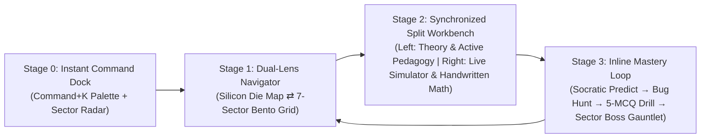

# KERNEL//BREACH — Visual Identity System, Flow Re-Architecture & Agent Execution Spec (For Agent: NEON)

> **Target Agent**: `NEON`  
> **Directive**: Rebuild and elevate the **KERNEL//BREACH** Operating Systems Study Companion (Silberschatz 10th Ed. · 21 Decks · 22 Interactive Simulators) into a modular **React 19 + Vite + TypeScript + Tailwind CSS + shadcn/ui + ReactBits** application while preserving 100% of the textbook knowledge trove, simulators, handwritten derivations, and verification invariants from [`index.html`](./index.html) and [`workspace_build_src/knowledge_trove/`](./workspace_build_src/knowledge_trove/).

---

## 1. Visual Identity Direction: *"Sovereign Silicon & Phosphor Precision"*

The visual identity merges **high-density hardware engineering telemetry** (Teenage Engineering / Lockheed Skunk Works / Wafer-Scale Silicon Lithography) with **tactile academic clarity** ( blueprint ruled margin sheets + high-contrast editorial typography). It avoids generic purple-gradient AI templates and eliminates heavy full-screen CSS blend/blur filters that cause GPU frame drops.

### 1.1 Color Architecture & `shadcn/ui` Token Contract (`index.css`)

All colors are mapped directly into `shadcn/ui` CSS variables plus 6 semantic OS domain tokens. Support **5 switchable palettes** (`cyan-lithography` default, `amber-crt`, `emerald-matrix`, `cobalt-bus`, and `paper-daylight` high-contrast light mode).

```css
@layer base {
  :root,
  [data-theme="cyan"] {
    /* Core Shadcn Surfaces — Wafer Obsidian & Anodized Slate */
    --background: 222 47% 4%;          /* #06090F — Deep Silicon Substrate */
    --foreground: 210 40% 96%;         /* #F0F6FC — Crisp Telemetry White */

    --card: 222 42% 7%;                /* #0B101B — Die Module Surface */
    --card-foreground: 210 40% 96%;

    --popover: 222 45% 6%;             /* #090D16 — Command / Codex Surface */
    --popover-foreground: 210 40% 96%;

    --primary: 184 100% 50%;           /* #00F0FF — Ring-0 Cyan Laser */
    --primary-foreground: 222 47% 4%;

    --secondary: 218 32% 13%;          /* #161F2E — Brushed Chassis Rail */
    --secondary-foreground: 210 30% 86%;

    --muted: 218 28% 11%;              /* #141B26 — Recessed Bus Trench */
    --muted-foreground: 215 18% 62%;   /* #8B9BB4 — Pinout Sub-label */

    --accent: 158 100% 50%;            /* #00FFA3 — Safe-State Emerald */
    --accent-foreground: 222 47% 4%;

    --destructive: 345 100% 58%;       /* #FF2A6D — Kernel Panic / Trap Crimson */
    --destructive-foreground: 210 40% 98%;

    --border: 217 33% 17%;             /* #1E293B — 1px Copper/Silicon Trace */
    --input: 217 33% 15%;
    --ring: 184 100% 50%;
    --radius: 0.375rem;                /* 6px precision chamfer/radius */

    /* Semantic OS Domain Tokens (Used by Simulators & 4-Color Lexicon) */
    --os-hw-cyan: #00F0FF;             /* Hardware, DMA, MMU, Registers, IVT */
    --os-sync-emerald: #00FFA3;        /* Semaphores, Mutex, Safe Sequences */
    --os-sched-amber: #FFB800;         /* CPU bursts, Quantum, Aging, Disk Seek */
    --os-trap-crimson: #FF2A6D;        /* Deadlocks, Page Faults, Race Hazards */
    --os-kernel-violet: #A855F7;       /* Kernel Structures, PCB, Inodes, VFS */
    --os-paper-bg: #0C1320;            /* "As Written By Hand" Blueprint Sheet */
    --os-paper-rule: rgba(0, 240, 255, 0.12);
    --os-paper-margin: rgba(255, 42, 109, 0.45);
  }

  [data-theme="light"] {
    --background: 210 33% 97%;         /* #F4F7FB — Clean Engineering Vellum */
    --foreground: 222 47% 11%;         /* #0F172A — Archival Ink */
    --card: 0 0% 100%;
    --card-foreground: 222 47% 11%;
    --popover: 0 0% 100%;
    --popover-foreground: 222 47% 11%;
    --primary: 192 95% 32%;            /* #047C9F — Deep Blueprint Cyan */
    --primary-foreground: 0 0% 100%;
    --secondary: 214 25% 91%;
    --secondary-foreground: 222 47% 14%;
    --muted: 214 25% 93%;
    --muted-foreground: 215 20% 38%;
    --accent: 158 85% 30%;
    --accent-foreground: 0 0% 100%;
    --destructive: 345 85% 46%;
    --destructive-foreground: 0 0% 100%;
    --border: 214 28% 82%;
    --input: 214 28% 84%;
    --ring: 192 95% 32%;
    --os-paper-bg: #FFFDF7;
  }
}
```

### 1.2 Typography Hierarchy

| Role | Font Family | Weights | Tracking & Rules |
| :--- | :--- | :--- | :--- |
| **Display & Sector Headers** | `'Space Grotesk'`, `'Chakra Petch'`, system-ui | `600`, `700` | `tracking-wider` (`0.06em`), uppercase for sector/deck tags |
| **Long-Form OS Theory & Callouts** | `'Plus Jakarta Sans'`, `'Inter'`, system-ui | `400`, `500`, `600`, `700` | `15px–16px` base, `1.68` line-height, comfortable reading scan |
| **Code, Registers, Traces & Math** | `'JetBrains Mono'`, `'Fira Code'`, monospace | `400`, `600`, `700` | `font-variant-numeric: tabular-nums` mandatory on all tables/clocks |

### 1.3 Surface & Material Grammar

1. **Precision 1px Bezel Cards**: 1px `hsl(var(--border))` borders with corner registration ticks (`+` crosshairs at top-left/bottom-right corners of major panels) and subtle `inset 0 1px 0 rgba(255,255,255,0.04)` top-edge highlight.
2. **GPU-Safe CRT Overlay**: Never use full-viewport `mix-blend-mode` or multi-gradient opacity layers. Use the single `4x4px` pre-decoded base64 PNG hairline tile on an isolated fixed layer (`transform: translate3d(0,0,0); contain: strict; pointer-events: none;`).
3. **"As Written By Hand" Exam Workings Sheet (`.handwritten-sheet`)**: Ruled graph-paper surface (`24px` horizontal lines, double vertical red margin line at `32px`) that renders live step-by-step formulas, substitutions, and boxed final answers (`⟹ Final Answer`) synchronized with every simulator slider.

---

## 2. Re-Architected User Flow: *"The Sovereign Split-Deck Flow"*



### Why the Old Flow Was Changed & How the New Flow Works

1. **Eliminating Modal-in-Modal Fatigue → Persistent App Shell (`<SidebarProvider>` + Top Telemetry Bar)**:
   - Replace scattered top-right utility buttons with a clean **Left Collapsible Rail** (`shadcn/ui <Sidebar>`) housing:
     - **Lens Switcher**: `Silicon Die Map` vs. `7-Sector Bento Track`
     - **7 Sector Jump Links** (`S1: Kernel Core` through `S7: Security Matrix`) with live mastery badges
     - **Quick Drawers**: `Formula Sandbox Sheet`, `A–Z Glossary`, `30-Mark Mock Midterm`, `Boss Raid Arena`, and `Operator Profile`
     - **State Pills**: `Red Pill (Unlock All — Full Access Mode)` & `Blue Pill (Reset Progress, Preserve Notes)`
   - Add a universal **`⌘K` / `Ctrl+K` Command Palette (`shadcn/ui <CommandDialog>`)** so pressing `⌘K` from anywhere searches all 21 decks, 408 OS keywords, 105 quiz questions, formulas, and simulators instantaneously.

2. **Upgrading the Linear List → 7-Sector Bento Stream**:
   - Instead of a plain vertical list, the Syllabus Track renders a **7-Sector Bento Grid**. Each sector header shows its **Kernel Capability Gate**, **Boss Gauntlet Trigger**, and completion bar, while each deck card uses **ReactBits `<SpotlightCard />`** showing live telemetry chips (`Sim ✓`, `Quiz x/5`, `Bugs x/2`, `Sabotage ✓`, `Notes 📝`).

3. **Eliminating Blind Tab-Switching → Synchronized Split-Screen Workbench (`shadcn/ui <ResizablePanelGroup>`)**:
   - In the previous single-tab workbench, students had to flip back and forth between Tab 1 (Simulator) and Tab 2 (Theory) to compare an equation with its live Gantt chart or page table.
   - **New Workbench Layout**:
     - **Desktop & iPad Landscape (`>= 1024px`)**: Defaults to a **Synchronized Split View** (`<ResizablePanelGroup direction="horizontal">`):
       - **Left Pane (52% default)**: **OS Theory & Active Pedagogy** (Intuition Hook, Silberschatz 10th Ed. sections, 4-color Highlighter, Recall Blur, Inline Sabotage, Socratic Predict, and Bug Hunts) with a floating Table-of-Contents pill.
       - **Right Pane (48% default)**: **Pinned Interactive Simulator (`W0–W19`) + Live "As Written By Hand" Exam Sheet + Exam Drill (`5 MCQs`)** inside a clean 2-tab switcher (`[⚡ Live Simulator]` / `[🎯 Exam Drill (5)]`).
       - **One-Click Layout Presets** in the Workbench Header: `[◫ Split Lab]` · `[📖 Full Theory]` · `[⚡ Full Simulator]` · `[📘 Codex & Notes Drawer]`.
     - **iPad Portrait & Mobile Phones (`< 1024px`)**: Automatically collapses into a full-width swipeable **3-Tab Segmented View (`<Tabs>`)** with a bottom/right **Slide-Over `<Sheet>`** for the Silberschatz Codex & Personal Notes and a bottom transport bar padded for iOS safe areas.

4. **Inline Micro-Checkpoints Instead of Bottom-Heavy Text Walls**:
   - Each deck's **Socratic Pause & Predict** and **Spot-the-Mistake Bug Hunts (`2/2`)** sit in interactive cards right below the core theory derivations, immediately rewarding XP with **ReactBits `<ClickSpark />`** and **`<CountUp />`** animations.

---

## 3. Mandatory `ReactBits` Integration Blueprint (For Agent `NEON`)

`NEON` MUST integrate the following **ReactBits** components at the exact locations below, obeying the **60fps Performance Budget** (never mount WebGL/heavy canvas backgrounds inside scrolling theory text; pause background canvases when the Split Workbench is open):

| ReactBits Component | Exact Placement in App | Purpose & Props Configuration |
| :--- | :--- | :--- |
| **`<DecryptedText />`** | Header Brand Title (`KERNEL//BREACH`), Deck Title on Workbench Open, and Capability Unlock Banner | Cybernetic character-decryption reveal (`speed={35}`, `maxIterations={12}`, `characters="01ABCDEF_//:"`, `animateOn="view"`). |
| **`<SpotlightCard />`** | All 21 Deck Cards in the **7-Sector Bento Track** and the **6 Pedagogical Callout Cards** | Tracks cursor/touch position with a subtle radial border/surface glow (`spotlightColor="rgba(0, 240, 255, 0.14)"`). |
| **`<Squares />` or `<DotGrid />`** | **Metroidvania Silicon Die Map** background substrate only (paused when Workbench is active) | Hardware wafer grid beneath the SVG orthogonal bus conduits (`direction="diagonal"`, `speed={0.2}`, `borderColor="rgba(30,41,59,0.55)"`, `hoverFillColor="rgba(0,240,255,0.06)"`). |
| **`<Magnet />`** | Die Map **IC Chip Nodes** (`.ic-chip-node`) and **Primary Action Buttons** (`SYNTHESIZE CAPABILITY`) | Subtle magnetic pull toward cursor on desktop (`padding={24}`, `magnetStrength={4}`, disabled on coarse touch pointers). |
| **`<ClickSpark />`** | Wraps the **Study Workbench**, **Quiz Option Buttons**, **Bug Hunt Fixes**, and **Capability Unlock Button** | Emits crisp cyan/emerald vector sparks on correct quiz answers, bug fixes, and capability unlocks (`sparkColor="#00FFA3"`, `sparkCount={10}`, `sparkRadius={22}`). |
| **`<CountUp />`** | Top Telemetry **XP Counter**, Simulator **EAT / Turnaround / Seek Distance Readouts**, and **Mock Exam Score** | Smooth tabular numeric interpolation (`duration={0.6}`, `separator=","`). |
| **`<ShinyText />`** | **Capability Unlocked Badges** (`RING_0`, `TLB_CACHE`, `DMA_CTRL`), **Rank Pill**, and **Red Pill** button | High-contrast metallic sweep across earned hardware capabilities (`speed={3}`). |
| **`<AnimatedList />`** | **A–Z Glossary Modal**, **Formula Sheet**, and **Command-K Search Results** | Staggered entrance and keyboard-navigable list transitions with zero layout thrash. |
| **`<StarBorder />`** | **Sector Boss Gauntlet Cards** (`S1–S7`) and **Active Node on the Silicon Die Map** | Animated traveling signal trace along the perimeter of the active IC node or Boss challenge (`color="#00F0FF"`, `speed="4s"`). |

---

## 4. Mandatory `shadcn/ui` Component Mapping (For Agent `NEON`)

`NEON` must install and style these `shadcn/ui` primitives using the Section 1.1 theme tokens:

1. **App Shell & Navigation**:
   - `<SidebarProvider>`, `<Sidebar>`, `<SidebarContent>`, `<SidebarGroup>`, `<SidebarMenuButton>`: Left collapsible command rail (Sectors `S1–S7`, Lens Switcher, Quick Tools, Red/Blue Pill).
   - `<CommandDialog>`, `<CommandInput>`, `<CommandList>`, `<CommandGroup>`, `<CommandItem>`: Global `⌘K` / `Ctrl+K` instant search across decks, glossary, formulas, and simulators.
   - `<Breadcrumb>`: Active sector & deck path in the Workbench top bar (`SEC_04 // DECK_14 // BANKER'S ALGORITHM`).
2. **Synchronized Split Workbench & Responsive Drawers**:
   - `<ResizablePanelGroup>`, `<ResizablePanel>`, `<ResizableHandle withHandle>`: Desktop & iPad Landscape split-screen (`Theory & Pedagogy` ⇄ `Live Simulator & Exam Drill`).
   - `<Tabs>`, `<TabsList>`, `<TabsTrigger>`, `<TabsContent>`: Mode switchers (`Split` / `Theory` / `Sim` / `Quiz`) and sub-simulator tabs (e.g., `Deck 05: SJF Gantt` vs `Exponential Averaging Lab`).
   - `<Sheet>` & `<Drawer>`: Right-hand **Silberschatz 10th Ed. Codex & Personal Notes** drawer (and mobile bottom sheet) + Section Outline / Saved Highlights drawer.
   - `<ScrollArea>`: Independent smooth scrolling for Theory pane, Simulator pane, and Codex drawer with a custom top reading progress bar.
3. **Interactive Simulators (`W0–W19`) & Formula Sandboxes**:
   - `<Slider>`: All live simulator parameters (CPU quantum $q$, smoothing $\alpha$, TLB hit ratio $h$, page frame count, disk head start position, Amdahl serial fraction $S$).
   - `<Select>`, `<Input>`, `<Switch>`, `<ToggleGroup>`: Algorithm pickers (`FCFS`, `SJF`, `SRTF`, `Priority`, `RR`; `FIFO`, `LRU`, `OPT`; `SSTF`, `SCAN`, `C-SCAN`, `LOOK`, `C-LOOK`), Strict Gate toggle, Recall Blur toggle, and Sabotage mode toggle.
   - `<Table>`, `<TableHeader>`, `<TableRow>`, `<TableCell>`: Process tables, Banker's matrices (`Allocation`, `Max`, `Available`, `Need`), Page tables, and Access Matrices.
4. **Pedagogy, Feedback & Modals**:
   - `<Dialog>`: Formula Sheet, A–Z Glossary, 30-Mark Practice Mock Midterm, Sector Boss Raid Arena, Operator Profile, and 6-Step Guided Tutorial.
   - `<Accordion>` & `<Collapsible>`: Socratic "Pause & Predict" reveals, Mock Midterm rubric solutions, and Worked Exam Trace breakdowns.
   - `<Tooltip>` & `<HoverCard>`: Instant glossary definition preview when hovering any of the **408 color-coded OS keywords** inline inside the theory text!
   - `<Badge>`, `<Progress>`, `<Sonner>` (Toast): Clearance telemetry, XP progress bar, and non-blocking hardware toast notifications.

---

## 5. Non-Negotiable Content, Conduct & Verification Invariants

When `NEON` builds the React + `shadcn/ui` + `ReactBits` application, it **MUST** obey these five rules:

1. **Zero Data Loss from the Existing Knowledge Trove**:
   - Do **not** rewrite or summarize the 21 decks into short placeholder paragraphs. Extract `CURRICULUM_NODES`, `THEORY_KNOWLEDGE_BASE`, `QUIZ_KNOWLEDGE_BASE`, `FORMULAS_DATA`, `GLOSSARY_DATA`, `KEYWORDS_LEXICON`, and `TEACHING_TROVE_DATA` directly from [`workspace_build_src/knowledge_trove/`](./workspace_build_src/knowledge_trove/) / [`index.html`](./index.html).
   - Preserve all **22 Interactive Simulators (`W0`–`W19`, including `W2B_AmdahlLab`, `W4_ExpAveragingLab`, `W4B_AgingLab`)** and their live **`.handwritten-sheet` ("As Written By Hand")** math derivations.
2. **Upgrade Keyword Hover with Shadcn `<HoverCard>`**:
   - When the 4-color semantic keyword engine wraps terms in `.kw-term` (`kw-hw`, `kw-sync`, `kw-sched`, `kw-hazard`), hovering or tapping a keyword matching `GLOSSARY_DATA` should display a crisp `<HoverCard>` with its Silberschatz 10th Ed. definition and module tag.
3. **Islamic Conduct Rules Compliance (Strict Enforcement)**:
   - Never use casual religious terminology such as `"God Mode"` (always use `"Full Access Mode"` for Red Pill).
   - Never include blasphemy, sacred text misuse, fabricated religious quotes, depictions of prophets/angels, or haram themes (gambling/alcohol/magic).
   - Keep the project's **Unofficial AI-Generated Study Companion** disclaimer badge (`UNOFFICIAL · AI`) and zero-instructor/zero-faculty affiliation notice intact in the header and README.
4. **Full iPad & Phone Touch Compatibility**:
   - Maintain 1-finger drag pan + 2-finger midpoint pinch-to-zoom (`touch-action: none`) on the Silicon Die Map, `16px` mobile inputs (preventing iOS Safari auto-zoom), `100dvh` + `env(safe-area-inset-bottom)` layout sizing, and `touchend` support for the 4-color text highlighter.
5. **Dual Build Output**:
   - Provide standard Vite dev/build scripts (`npm run dev`, `npm run build`) producing a static bundle ready for GitHub Pages (`https://md7br.github.io/OS_CPCS/`).

---

## 6. Copy-Paste Kickoff Prompt for Agent `NEON`

> **Prompt to give `NEON`:**
>
> Read `NEON_VISUAL_IDENTITY_AND_HANDOFF.md` and `STUDY_COMPANION_BLUEPRINT.md` first. Transform **KERNEL//BREACH** into a **React + Vite + TypeScript + Tailwind CSS + shadcn/ui + ReactBits** application following the exact **"Sovereign Silicon & Phosphor Precision"** visual identity (Section 1), the **"Sovereign Split-Deck Flow"** with `<SidebarProvider>`, global `⌘K` `<CommandDialog>`, 7-Sector Bento Track, and `<ResizablePanelGroup>` Synchronized Split Workbench (Section 2), the mandatory **ReactBits** component placements (`<DecryptedText />`, `<SpotlightCard />`, `<Squares />`, `<Magnet />`, `<ClickSpark />`, `<CountUp />`, `<ShinyText />`, `<AnimatedList />`, `<StarBorder />` in Section 3), and the **shadcn/ui** component mapping (Section 4). Extract 100% of the 21 decks, 408 keywords, 105 quiz items, formulas, glossary, teaching trove, and 22 interactive simulators (`W0–W19` + handwritten math sheets) from `index.html` / `workspace_build_src/knowledge_trove/` with zero content truncation and strict compliance with Section 5.
