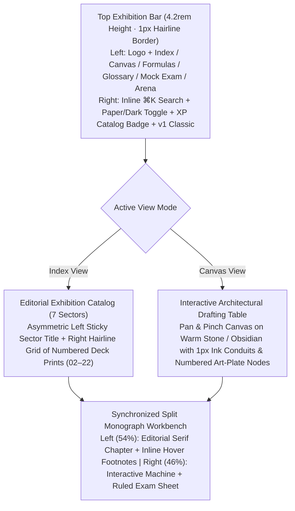

# KERNEL//BREACH — Shutabug-Inspired Visual Identity & Flow Specification (For Agent: NEON)

> **Design Reference**: [shutabug.com](https://shutabug.com/) (Awwwards / CSS Design Awards — designed by The Blackpepper Studio for Mayowa Alabi)  
> **Aesthetic Direction**: *"Archival Monograph & Kinetic Gallery Studio"*  
> **Target Agent**: `NEON` (React 19 + Vite + TypeScript + Tailwind CSS + `shadcn/ui` + `ReactBits`)

---

## 1. Core Aesthetic Philosophy: Why Shutabug Works & How It Transforms KERNEL//BREACH

Instead of a cold, dark-only sci-fi terminal overloaded with neon glow, **Shutabug (`shutabug.com`)** achieves its iconic feel through **four signature contrasts**:

1. **Warm Archival Paper & Sumi Carbon Ink (Default Daylight-First, with Pitch Obsidian Dark Mode)**:
   - The default canvas is **Warm Gallery Stone (`#F2F2F0`)** paired with **Deep Sumi Carbon Ink (`#111110`)**, **Warm Stone Pewter (`#686865`)**, and **14% Ink Hairline Rules (`color-mix(in srgb, var(--ink) 14%, transparent)`)**.
   - Toggling Dark Mode flips effortlessly to **Pitch Gallery Obsidian (`#0A0A09` / `#000000`)** with **Chalk White (`#FFFFFF`)**, **Warm Ash (`#8A8A83`)**, and **Brushed Gold Ochre (`#C9A961`)**.
2. **The Three-Voice Typography System (Sculptural Display + Literary Serif + Wide-Tracked Micro-Mono)**:
   - **Voice 1 — Display Headers (`--font-display`)**: Bold, sculptural uppercase display type (`'Syne'` / `'Bricolage Grotesque'`, echoing Shutabug's uppercase gallery headings at `line-height: 1`, `letter-spacing: 0.01em`).
   - **Voice 2 — Editorial Serif Prose (`--font-body`)**: High-contrast literary serif (`'Newsreader'` / `'Source Serif 4'`, echoing Shutabug's *Kalice / Times* body serif) for long-form Silberschatz 10th Ed. theory, turning dense OS chapters into an effortless, magazine-grade reading experience.
   - **Voice 3 — Micro-Chrome Monospace (`--font-mono`)**: Crisp `11px` (`0.6875rem`) uppercase monospace with wide tracking (`letter-spacing: 0.14em`) used strictly for navigation chrome, catalog numbers (`DECK 02 · §1.1–§2.10`), telemetry pills, `⌘K` search triggers, and hardware registers.
3. **1px Hairline Architecture & Sharp Gallery Corners (`2px–4px` Radius)**:
   - Replace heavy drop shadows and thick neon borders with **full-bleed `1px solid var(--line)` architectural hairlines**, sharp `2px–4px` corners (`--radius-sm: 2px; --radius-md: 4px`), pill badges (`999px`), and subtle warm paper grain.
4. **Tactile Micro-Interactions**:
   - **Ink-Invert Hover States**: Buttons and circular close triggers invert cleanly on hover (`background: var(--ink); color: var(--bg)`), with close buttons rotating `90deg` (`transform: rotate(90deg)`).
   - **Animated Baseline Underlines**: Navigation links and catalog rows animate a `1px` underline from left to right (`transform-origin: 0; transform: scaleX(0 -> 1)` over `0.32s cubic-bezier(.2, .7, .2, 1)`).
   - **Paper Set-Down & Unfold Motion**: Cards and floating drawers settle with Shutabug's signature spring easing (`--ease-out: cubic-bezier(.22, 1, .36, 1)`).

---

## 2. Exact Color & Token Contract (`index.css`)

Extracted directly from `shutabug.com`'s root CSS variables and mapped to `shadcn/ui` HSL tokens + OS domain accents:

```css
@layer base {
  :root,
  [data-theme="paper"] {
    /* Shutabug Root Tokens — Warm Gallery Stone (Default) */
    --shuta-bg: #F2F2F0;
    --shuta-ink: #111110;
    --shuta-dim: #686865;
    --shuta-line: rgba(17, 17, 16, 0.14);
    --shuta-line-strong: rgba(17, 17, 16, 0.55);
    --shuta-panel: #E8E8E4;
    --shuta-card: #F8F8F6;
    --shuta-veil: rgba(242, 242, 240, 0.78);
    --shuta-warn: #7A5F24;      /* Archival Ochre / Brass */
    --shuta-live: #17703C;      /* Botanical Gallery Green */
    --shuta-error: #A40000;     /* Editorial Carmine */
    --shuta-accent: #D94E1F;    /* Lagos Terracotta / Vermilion Accent */

    /* Mapped Shadcn HSL Variables */
    --background: 60 6% 95%;           /* #F2F2F0 */
    --foreground: 60 3% 6%;            /* #111110 */
    --card: 60 11% 97%;                /* #F8F8F6 */
    --card-foreground: 60 3% 6%;
    --popover: 60 11% 97%;
    --popover-foreground: 60 3% 6%;
    --primary: 60 3% 6%;               /* #111110 — Sumi Ink Primary */
    --primary-foreground: 60 6% 95%;   /* #F2F2F0 */
    --secondary: 60 6% 90%;            /* #E8E8E4 */
    --secondary-foreground: 60 3% 6%;
    --muted: 60 6% 90%;
    --muted-foreground: 60 2% 40%;     /* #686865 */
    --accent: 145 66% 26%;             /* #17703C */
    --accent-foreground: 60 11% 97%;
    --destructive: 0 100% 32%;         /* #A40000 */
    --destructive-foreground: 60 11% 97%;
    --border: 60 3% 82%;               /* 1px Hairline Rule */
    --input: 60 3% 80%;
    --ring: 60 3% 6%;
    --radius: 0.25rem;                 /* 4px Shutabug gallery radius */

    /* OS Simulator & Keyword Bridge Tokens */
    --color-cyan: #111110;
    --color-amber: #9A6B13;
    --color-emerald: #17703C;
    --color-crimson: #A40000;
    --color-violet: #5B3E96;
    --bg-deep: #F2F2F0;
    --bg-panel: #F8F8F6;
    --bg-card: #FFFFFF;
    --border-trace: rgba(17, 17, 16, 0.14);
    --border-light: rgba(17, 17, 16, 0.22);
    --text-primary: #111110;
    --text-secondary: #2C2C2A;
    --text-muted: #686865;
    --os-paper-bg: #FAF8F2;
    --os-paper-rule: rgba(17, 17, 16, 0.08);
    --os-paper-margin: rgba(164, 0, 0, 0.35);
    --spotlight-rgb: 17, 17, 16;
  }

  [data-theme="dark"] {
    /* Shutabug Dark Mode — Pitch Obsidian & Warm Gold Ochre */
    --shuta-bg: #080807;
    --shuta-ink: #F5F5F2;
    --shuta-dim: #8A8A83;
    --shuta-line: rgba(245, 245, 242, 0.14);
    --shuta-line-strong: rgba(245, 245, 242, 0.55);
    --shuta-panel: #121210;
    --shuta-card: #0E0E0C;
    --shuta-veil: rgba(8, 8, 7, 0.78);
    --shuta-warn: #C9A961;
    --shuta-live: #4CCF7F;
    --shuta-error: #FF8A80;
    --shuta-accent: #FF6B35;

    --background: 60 6% 3%;            /* #080807 */
    --foreground: 60 12% 96%;          /* #F5F5F2 */
    --card: 60 8% 6%;                  /* #0E0E0C */
    --card-foreground: 60 12% 96%;
    --popover: 60 8% 6%;
    --popover-foreground: 60 12% 96%;
    --primary: 60 12% 96%;             /* #F5F5F2 */
    --primary-foreground: 60 6% 3%;
    --secondary: 60 6% 10%;
    --secondary-foreground: 60 12% 92%;
    --muted: 60 6% 9%;
    --muted-foreground: 60 3% 53%;     /* #8A8A83 */
    --accent: 143 58% 55%;             /* #4CCF7F */
    --accent-foreground: 60 6% 3%;
    --destructive: 5 100% 75%;         /* #FF8A80 */
    --destructive-foreground: 60 6% 3%;
    --border: 60 4% 16%;
    --input: 60 4% 16%;
    --ring: 42 49% 58%;

    --color-cyan: #C9A961;
    --color-amber: #E5A93C;
    --color-emerald: #4CCF7F;
    --color-crimson: #FF8A80;
    --color-violet: #C4B5FD;
    --bg-deep: #080807;
    --bg-panel: #0E0E0C;
    --bg-card: #141412;
    --border-trace: rgba(245, 245, 242, 0.14);
    --border-light: rgba(245, 245, 242, 0.24);
    --text-primary: #F5F5F2;
    --text-secondary: #D6D6D0;
    --text-muted: #8A8A83;
    --os-paper-bg: #11110E;
    --os-paper-rule: rgba(201, 169, 97, 0.1);
    --os-paper-margin: rgba(255, 138, 128, 0.4);
    --spotlight-rgb: 201, 169, 97;
  }
}
```

---

## 3. Typography & Micro-Chrome Rules

Load from Google Fonts in `index.html`:
- **`Syne` (`700`, `800`)** — `--font-display`: Sculptural gallery headlines, deck titles, and drawer headers (`text-transform: uppercase; letter-spacing: 0.01em; line-height: 1.02`).
- **`Newsreader` (`400`, `500`, `600`, italic `400`)** — `--font-body`: Editorial serif for all Silberschatz 10th Ed. prose, intuition narratives, definitions, and exam explanations (`font-size: 1.04rem; line-height: 1.72`).
- **`JetBrains Mono` (`400`, `600`, `700`)** — `--font-mono`: Technical chrome (`font-size: 0.6875rem; letter-spacing: 0.14em; text-transform: uppercase`) + tabular code, Gantt charts, and math derivations.

---

## 4. Shutabug-Style Layout & Navigation Flow



### Key Structural Shifts Inspired by `shutabug.com`

1. **Top Horizontal Exhibition Bar (`4.2rem` height) Instead of a Heavy Left Sidebar**:
   - Just like `shutabug.com`'s `<header class="top">` (`Index` · `Shop` · `Info` · `Auctions` · `Help` on the left; inline `Search ⌘K` · `Theme Sun/Moon` · `Saved` · `Bag` on the right):
   - Replace the permanent 256px left sidebar with a **full-width `4.2rem` Exhibition Header** giving **100% of horizontal screen width** to the Catalog, Drafting Canvas, and Split Workbench!
   - **Left Nav Links** (with animated `scaleX(0 -> 1)` 1px underline):
     - `Index` (Editorial Catalog Grid)
     - `Canvas` (Spatial Dependency Map)
     - `Formulas` (26 Equations Drawer)
     - `Glossary` (134 Terms Drawer)
     - `Mock Exam` (30-Mark Practice Paper)
     - `Gauntlets` (7 Sector Boss Arenas)
   - **Right Chrome Actions**:
     - Inline `Search · ⌘K` pill
     - Sector filter dropdown (`All Sectors` / `S1`..`S7`)
     - `Red Pill` (`Full Access`) / `Blue Pill` (`Reset`) minimal micro-chrome buttons
     - Sun / Moon (`Paper #F2F2F0` ⇄ `Dark #080807`) icon button
     - Operator Rank & XP counter (`LVL X · N XP`)

2. **Asymmetric Editorial Catalog (`Index` View)**:
   - Each of the 7 Sectors renders as an **Editorial Exhibition Section** separated by a full-width `1px solid var(--line)` rule:
     - **Left Column (`lg:col-span-4`, sticky while scrolling the sector)**: Big sculptural `01`–`07` numeral (`font-display text-4xl`), Sector Title, Silberschatz Chapter range, Mastery progress bar, and a minimal **`Engage Sector Gauntlet →`** link.
     - **Right Column (`lg:col-span-8`)**: Hairline-divided grid of **Print-Plate Deck Cards (`02`–`22`)** featuring an archival plate number (`PLATE № 02`), serif deck summary, capability stamp, and hover ink-inversion preview.

3. **Slide-Over Monograph Drawers (`.a0qCAG_panel` Pattern)**:
   - Side drawers (Codex & Notes, Formula Sheet, Glossary) use Shutabug's frosted veil (`backdrop-filter: blur(6px)`), `1px solid var(--line)` left border, large uppercase display title (`1.9rem`), and the **circular `2.4rem` close button that inverts and rotates `90deg` on hover**!
